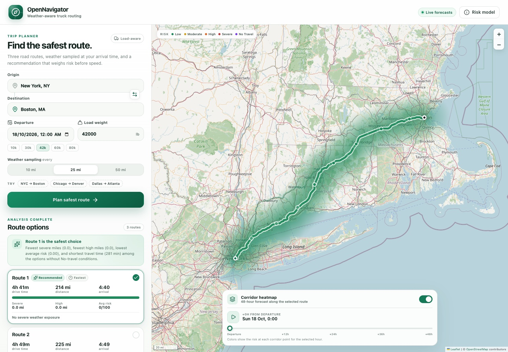
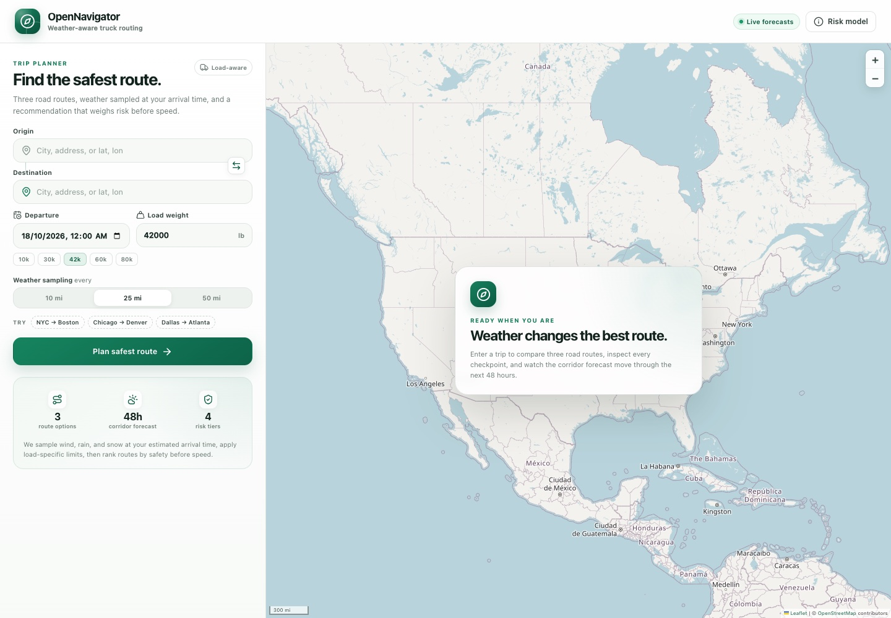
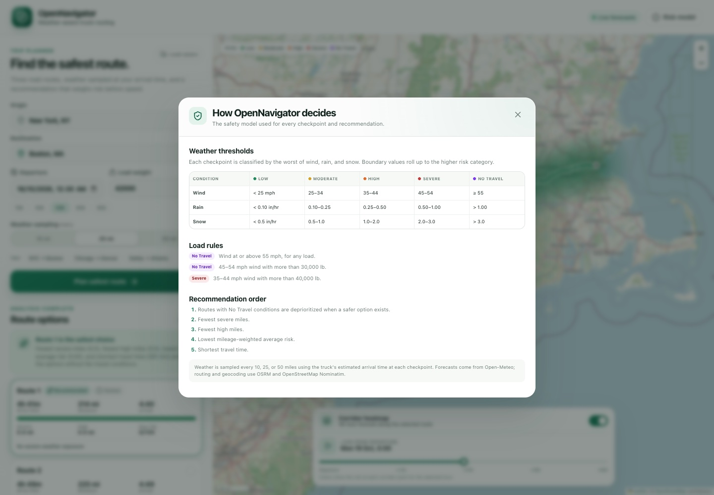
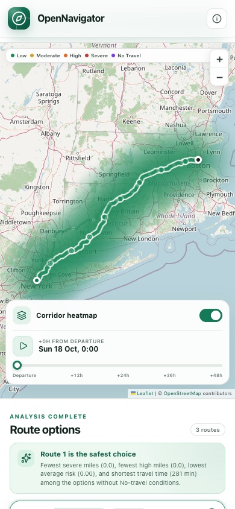
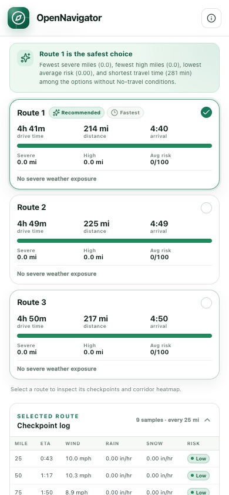

# OpenNavigator

Weather-aware truck routing for safer dispatch decisions.

OpenNavigator compares three real road routes, samples the forecast at each truck's estimated arrival time, applies weather and load safety rules, and recommends the safest option before speed. A 0–48 hour corridor heatmap lets dispatchers see how conditions evolve along the selected route.

**Hosted application:** <https://opennavigator.206.81.6.97.sslip.io>



## What it does

- Geocodes origin and destination from a city, address, or `lat, lon`.
- Requests three driving routes from OSRM, adding corridor detours when the routing engine returns fewer alternatives.
- Samples wind, rain, and snow every 10, 25, or 50 miles at the checkpoint's estimated arrival time.
- Classifies each checkpoint as Low, Moderate, High, Severe, or No Travel using the assessment thresholds and load rules.
- Ranks routes by No Travel exposure, severe miles, high miles, mileage-weighted average risk, and travel time.
- Shows all routes, risk-colored geometry, checkpoints, ETAs, weather, and summaries on an interactive map.
- Renders a 0–48 hour forecast heatmap along the selected corridor with a time slider and playback.

| Empty state | Risk model |
| --- | --- |
|  |  |

| Mobile map | Mobile results |
| --- | --- |
|  |  |

## Stack

| Layer | Technology |
| --- | --- |
| Frontend | React 19, TypeScript, Vite, Leaflet, plain CSS |
| Backend | Django 5.2, Django REST Framework, Python 3.12+ |
| Data | PostgreSQL in production, SQLite for local development |
| Routing | OSRM demo server |
| Geocoding | OpenStreetMap Nominatim |
| Weather | Open-Meteo hourly forecast |
| Runtime | Gunicorn + nginx, systemd, Let's Encrypt |

No paid API keys are required. All external services are called server-side and cached.

## How a request flows

1. The browser posts origin, destination, departure time, load weight, and sampling interval.
2. Django geocodes both endpoints and requests up to three driving routes.
3. The domain layer builds checkpoint samples from the routing steps, interpolating position and ETA every 10/25/50 miles.
4. Weather is fetched in six-hour buckets, then read at each checkpoint's arrival hour.
5. The risk policy classifies each checkpoint and applies load overrides.
6. The recommendation policy ranks the routes and the plan is persisted for heatmap lookups.
7. The React client renders risk-colored route segments, checkpoint popups, route summaries, and the forecast heatmap.

See [Architecture](docs/ARCHITECTURE.md) and [Risk model](docs/RISK_MODEL.md) for details.

## Local development

### Prerequisites

- Python 3.12+
- Node.js 22+ and pnpm 10+
- No API keys or database server required for local development

### Backend

```bash
python3 -m venv .venv
.venv/bin/pip install -r backend/requirements-dev.txt
cd backend
../.venv/bin/python manage.py migrate
../.venv/bin/python manage.py runserver 127.0.0.1:8000
```

Local development uses SQLite at `backend/var/db.sqlite3` and Django's file cache.

### Frontend

```bash
cd frontend
pnpm install
pnpm dev
```

Open <http://localhost:5173>. Vite proxies `/api` to `http://127.0.0.1:8000`.

### Tests and checks

```bash
make test       # backend + frontend tests
make lint       # ruff + TypeScript
make build      # production frontend build
```

- Backend: 97 pytest tests covering risk boundaries, checkpoint interpolation, recommendation ordering, use cases, adapters, persistence, and API contracts.
- Frontend: 21 Vitest/Testing Library tests covering formatting, risk presentation, geometry slicing, the planner form, route cards, and heatmap controls.

## Configuration

Copy `.env.example` to `.env` for production overrides. Local defaults work without an env file.

| Variable | Default | Purpose |
| --- | --- | --- |
| `DJANGO_SECRET_KEY` | dev-only value | Django secret; required in production |
| `DJANGO_DEBUG` | `false` | Debug mode |
| `DJANGO_ALLOWED_HOSTS` | `localhost,127.0.0.1,testserver` | Comma-separated hosts |
| `DJANGO_CSRF_TRUSTED_ORIGINS` | empty | HTTPS origins for admin/CSRF (not used by the public API) |
| `DB_NAME` | empty | If set, use PostgreSQL; otherwise SQLite |
| `DB_USER`, `DB_PASSWORD`, `DB_HOST`, `DB_PORT` | empty / `127.0.0.1` / `5432` | PostgreSQL connection |
| `DATA_DIR` | `backend/var` | Cache and local database directory |
| `PLAN_RETENTION_HOURS` | `24` | How long plans remain available for heatmap requests |
| `MAX_TRIP_DAYS` | `14` | Forecast horizon for departures |
| `OSRM_BASE_URL` | `https://router.project-osrm.org` | Routing provider |
| `NOMINATIM_BASE_URL` | `https://nominatim.openstreetmap.org` | Geocoder |
| `OPEN_METEO_BASE_URL` | `https://api.open-meteo.com/v1` | Weather provider |
| `HTTP_USER_AGENT` | project identifier | Required by Nominatim |

## API

Base URL: `/api/v1`

| Method | Path | Purpose |
| --- | --- | --- |
| `GET` | `/health/` | Liveness and version |
| `GET` | `/config/` | Sampling intervals, forecast horizon, risk labels |
| `POST` | `/trips/plan/` | Plan a trip and receive three analysed routes |
| `GET` | `/trips/{plan_id}/heatmap/?route_id=...&hour=0..48` | Corridor forecast frame |

Example:

```bash
curl -X POST https://opennavigator.206.81.6.97.sslip.io/api/v1/trips/plan/ \
  -H 'Content-Type: application/json' \
  -d '{
    "origin": "New York, NY",
    "destination": "Boston, MA",
    "departure": "2026-10-18T16:00:00Z",
    "load_weight_lb": 42000,
    "sampling_interval_miles": 25
  }'
```

See [API documentation](docs/API.md) for full request and response shapes, error codes, and examples.

## Deployment

The app is deployed to the shared `opennikkah` server at `/opt/opennavigator`:

- Django/Gunicorn bound to `127.0.0.1:8010`
- nginx site `opennavigator.206.81.6.97.sslip.io` with Let's Encrypt TLS
- Dedicated `opennavigator` system user and PostgreSQL role/database
- systemd service `opennavigator-web`
- Daily database backup timer `opennavigator-backup.timer`

Frontend builds happen on the local Mac; only static artifacts and Python source are shipped. See [Deployment](docs/DEPLOYMENT.md) for the runbook and [deploy](deploy/) for unit/nginx templates.

## Documentation

- [Architecture](docs/ARCHITECTURE.md)
- [Risk model](docs/RISK_MODEL.md)
- [API reference](docs/API.md)
- [Deployment runbook](docs/DEPLOYMENT.md)
- [Loom walkthrough script](docs/WALKTHROUGH.md)
- [Assumptions and limits](docs/ASSUMPTIONS.md)

## License

MIT. See [LICENSE](LICENSE).
